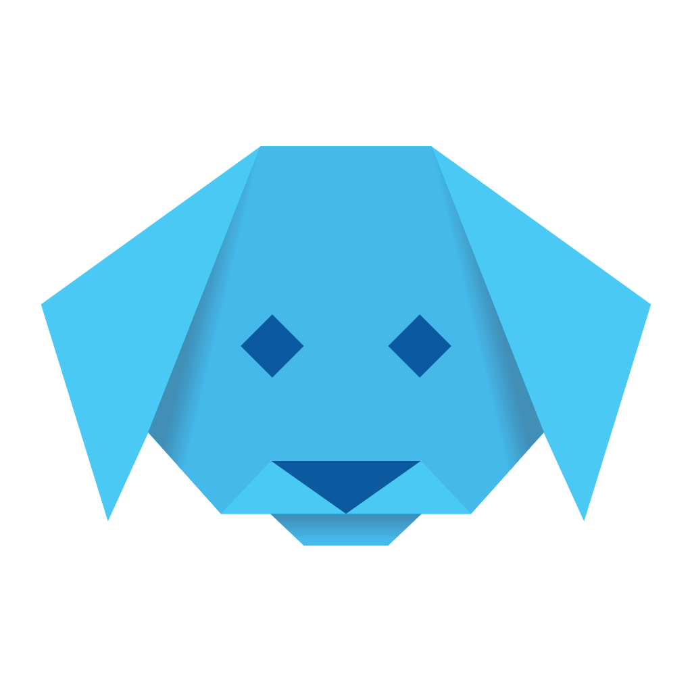

<h1 align="left">
    
    Dart Object Graphs
    <a href="https://pub.dev/packages/dogs_core">
        
    </a>
    <a href="https://github.com/helightdev/dogs/actions">
        
    </a>
    <a href="https://dogs.helight.dev/">
        
    </a>
</h1>

DOGs (Dart Object Graphs) is a serialization and object-mapping library for Dart that turns your classes into
introspectable, immutable, and easily validated data models across multiple formats.

[Documentation](https://dogs.helight.dev) |
[Discord](https://discord.gg/6HKuGSzYKJ) |
[Pub Package](https://pub.dev/packages/dogs_core)

```dart
@serializable
class Person with Dataclass<Person> {

  @LengthRange(max: 128)
  final String name;

  @Minimum(18)
  final int age;

  @SizeRange(max: 16)
  @Regex("((_)?[a-z]+[A-Za-z0-9]*)+")
  final Set<String>? tags;

  Person(this.name, this.age, this.tags);

}
```

* 🐦 **Concise** Define immutable dataclasses with a simple annotation and mixin. toString, equals, hashCode, and
  builders are generated automatically. No equatable, no copyWith, no additional boilerplate.
* 🚀 **Fast** Optimized serialization and deserialization with performance on par or better than alternatives. JSON
  support is built in with zero extra dependencies.
* 🧩 **Extensible**
  Replace or extend any part of the pipeline. Add new formats, validators, projections, or field converters. Works with
  custom Flutter types through the integration package.
* 📦 **Adaptive** Multiple formats supported out of the box: JSON, YAML, TOML, CBOR. Schema generation enables dynamic
  use cases like server-driven forms.
* 📚 **Documented** Comprehensive documentation and examples
* ⚡ **Developer-friendly** All generated code goes into a single dogs.g.dart. Models remain clean and free of part
  directives. Builders and nullable copy methods are exposed centrally.

## Format Support

- **JSON** (included in dogs_core)
- **YAML** <a href="https://pub.dev/packages/dogs_yaml"></a>
- **TOML** <a href="https://pub.dev/packages/dogs_toml"></a>
- **CBOR** <a href="https://pub.dev/packages/dogs_cbor"></a>

## Core Package <a href="https://pub.dev/packages/dogs_core"></a>

- **Json**  
  The core package comes with json support out of the box and requires no additional dependencies.

- **Builders & Nullable Copy**  
  We provide a nullable copy method that also works with null values, as well as autogenerated builders, similar to
  built_value. Both let you create immutable objects with a simple and fluent api.

- **Structures**  
  Every serializable class has an introspectable generated `DogStructure` that provides runtime access to the class's
  fields, annotations, factories and metadata. Together with the extensible core system, you can build powerful
  reflection-like functionality without the need for custom code generation or mirrors.

- **Dataclasses**  
  Using our dataclass mixin automatically implements toString, equals and hashCode for your
  serializable classes. This removes the requirement for a package like equatable or
  ungodly amounts of boilerplate code, that is hard to maintain and distracting.

- **Projections**  
  Dogs offers a powerful projection api, which enables you to transform your objects into
  other objects, without having to write additional boilerplate code with brittle `copyWith`
  invocations and hard coded key names.

- **Polymorphism**  
  Dogs supports polymorphic serialization, which enables you to serialize and deserialize
  objects of different types. You can even use interfaces and abstract classes as types,
  including `Object`.

- **Validation**  
  Using the validation api, you can easily validate your objects, without having the struggle
  of writing your own validation logic for most common use cases. Translation of messages and
  custom validators are supported as well.

- **JsonSchema-like Schema** (preview)  
  Dogs offers a schema generation api, which allows you to dynamically export and parse a subset
  of json-schema. This enables advanced dynamic uses cases such as partially server-driven forms when used
  in combination with the flutter integration.

[Package on pub.dev](https://pub.dev/packages/dogs_core)  
[Documentation](https://dogs.helight.dev)

## Declarative JSON model mapping

`DogModelCodec` is an opt-in reader for APIs that need strict Dart casts and
stable request keys. It uses the existing generated structures and does not
change native `DogEngine.fromNative` behavior. Import `dogs_models.dart` to use
its annotations:

```dart
import 'package:dogs_core/dogs_models.dart';
import 'dogs.g.dart';

@JsonModel(outputKeys: ['id', 'name'])
class City {
  @JsonKey(aliases: ['legacy_id', 'id'])
  final int? id;

  final String? name;

  City({this.id, this.name});
}

final models = DogModelCodec(
  engine: configureDogs(plugins: [GeneratedModelsPlugin()]),
);
final city = models.fromJson<City>({'legacy_id': 1, 'name': 'Erbil'});
final request = models.toJson(city); // {'id': 1, 'name': 'Erbil'}
```

`@JsonModel` also marks the class for DOGs generation. The codec reads
registered nested models and lists recursively.
`@JsonModel(emptyListsOnNull: true)` supplies fresh typed empty lists for
missing or null list fields on that model. Use one `@JsonKey(...)` per field:
`aliases` for alternate input names, `name` for an explicit input key,
`convert` for whole-value conversion (for example `JsonConversions.stringify`
or `JsonConversions.flagInt`), `each` for list-element conversion,
`parse` for nested object maps (or each list element map), `read` when the
rule needs the full parent map, and `value` to force a decode value
(including explicit `null`). Callback arguments must be constant top-level or
static function tear-offs for generated metadata (factory constructor
tear-offs are not retained by codegen).

`toJson` returns raw constructor values, including nulls and nested model
instances. Use `engine.toNative` for a recursively serialized object graph.
Applications can subclass `DogModelGuard` to customize nested parsing errors.

## Flutter <a href="https://pub.dev/packages/dogs_flutter"></a>

Use our flutter integration to easily create forms for any serializable object, without having
to write boilerplate code. The databinding system supports all primitive field types and can easily
be extended to support custom field types and layouts. This package also provides converters for
commonly used flutter types, like `Color`, `Offset`, `Size`, `Rect`, etc.

[Package on pub.dev](https://pub.dev/packages/dogs_flutter)  
[Documentation](https://dogs.helight.dev/flutter/)

## ✨ Non-Intrusive Code Generation ✨

Dogs takes a different approach to generated code. Instead of scattering part files across your models,
all generated output lives in a single dogs.g.dart file at the root of your lib folder. This makes development smoother
and far less error-prone. No more missing part statements or fragile imports.

Even better: your model definitions stay clean. You never need to reference generated code inside them. The only time
you’ll interact with generated code directly is when using builders, which are neatly exported through
the central dogs.g.dart.

This design keeps Dogs non-intrusive and future-proof. While part files may be added later for flexibility,
you will never be required to reference generated code from within your model definition files.
